<h1 align="center">TiO₂</h1>

<p align="center"><i>钛白，颜料里最白的一种。它不成画，只让落在上面的颜色更准。</i></p>

<p align="center">
  
  
  
</p>


https://github.com/user-attachments/assets/d4be5f3d-c178-4c22-b32e-7b52af324da2


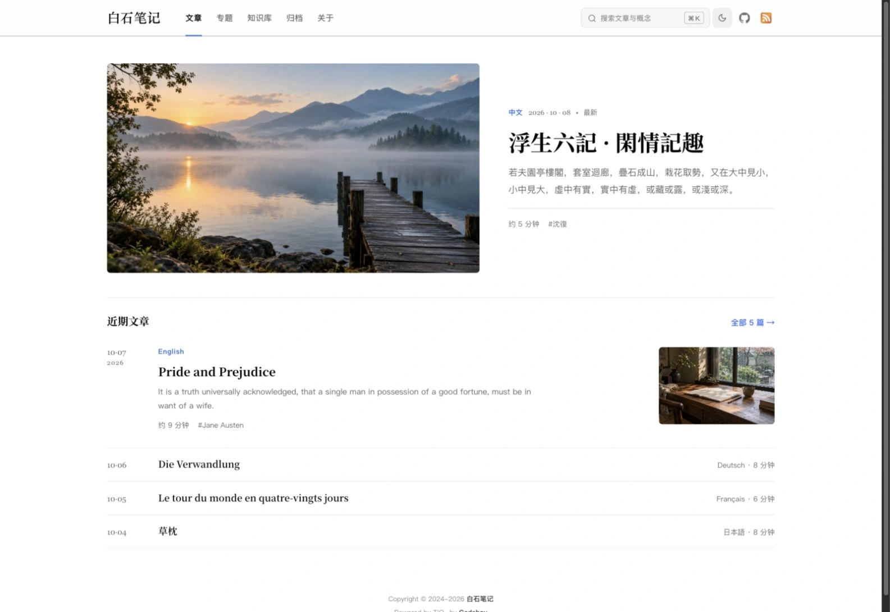

TiO₂ 是一个静态博客框架，为长文与结构化知识而作。

它把一个 Markdown 目录排成一座安静、耐读的站点：文章、连载专题，以及一座概念之间彼此声明依赖的知识库。没有数据库，没有后端；你写下的每个字，始终是硬盘上的一份文件。

### 取舍

**注重阅读体验。**　宋体标题，克制的留白，明暗两套墨色。公式在构建期排好，页面打开即是成品。

**链接是一等公民。**　`[[双链]]`、嵌入引用、块级锚点、反向链接。写得够久，文章自己会长成一张网。

**知识有结构。**　每个概念一页，用六种关系说明它从哪里来、往哪里去；关系图、概念全图与学习路线由此自动生成。

**本地优先。**　搜索、解密、时间戳验证都在浏览器里完成。首屏脚本约 7.5 KB（gzip），其余按需加载。

**错误止于构建。**　坏链接、成环的依赖、缺失的图片，会在发布之前报错，而不是被读者发现。

## 阅读体验

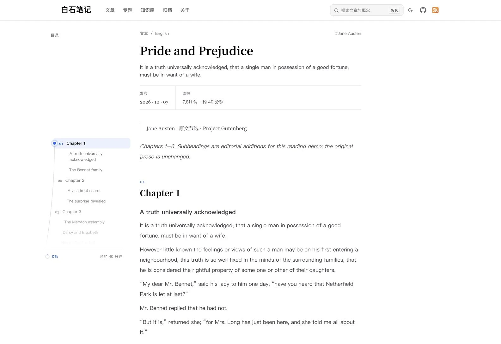

| 功能 | 说明 |
| :--- | :--- |
| **数学** | MathJax 构建期渲染；选中复制时公式自动还原为 LaTeX |
| **代码** | Shiki 高亮，明暗双色、行号、行高亮，长代码可折叠 |
| **图片** | 自动生成 AVIF / WebP 响应式图片，懒加载，点击放大查看 |
| **容器** | 提示 / 警告 / 详情、内容折叠 `::: fold`、口令加密 `::: encrypt`（AES-GCM，浏览器内解密） |
| **索引页** | 时间线归档、分类、标签、专题树，放一个同名 Markdown 即启用 |

| 功能与说明 | 演示 |
| --- | --- |
| **阅读导航**<br>编号目录、阅读进度与剩余时间。 | 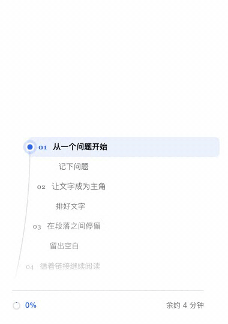 |
| **页边注**<br>脚注同步显示为页边「边注」。 | 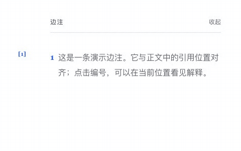 |
| **引用**<br>悬停预览站内链接；选中文字可复制引文或直达该段的链接。 |  |
| **AIGC 披露**<br>在 front matter 标注 `aigcRate` 与模型，或声明 `humanWritten: true` 获得一枚「亲笔」签名。 | 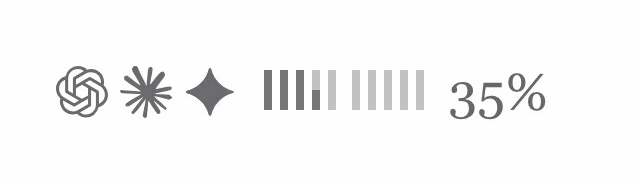<br> |
| **本地搜索**<br>`⌘K` 唤起本地全文搜索（MiniSearch），文章、专题、知识库条目一次查全，无需任何搜索服务。 | 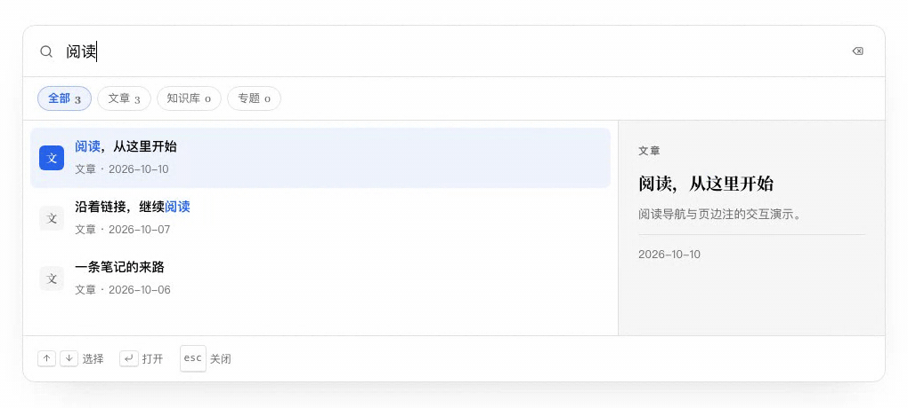 |

## 知识库

博客记录一次探索，知识库保存可以反复引用的概念。定义、定理、算法与方法各有独立条目，用稳定 ID 连接起来；学科分类、概念关系和学习路线分别表达「属于哪里」「与谁有关」「按什么顺序读」。

### 从检索、学科与问题进入

知识库首页提供三个入口：按名称、别名或描述查概念，按学科展开目录，以及从一个具体问题选择学习路线。检索可同时按条目类型与学科筛选。一个概念可以属于多个学科，不必复制成几份文档。

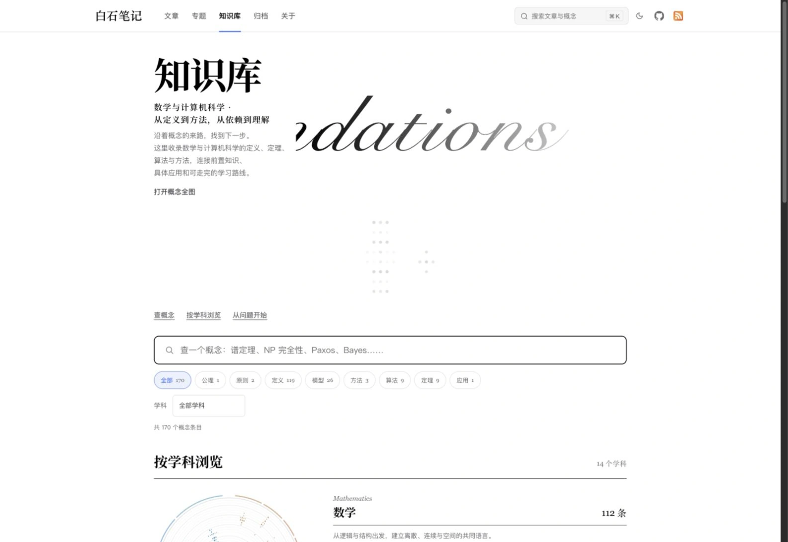

展开一个学科后，目录列出概念类型、中英文名称、简述及直接前置和后续数量；旁边的学科星盘同步定位这一组概念。


### 一份 Markdown 保存一个概念

例如 `least-squares-and-normal-equations.md` 可以这样声明；其中的学科需要先在 `foundations.groups` 配置，关系目标需要有对应条目：

```yaml
---
title: 最小二乘与正规方程
id: least-squares-and-normal-equations
aliases: [Least squares, Normal equations]
kind: theorem
domains: [mathematics/algebra-structures]
requires: [system-of-linear-equations, orthogonal-projection]
uses: [singular-value-decomposition]
implemented_by: [least-squares-via-qr-and-svd]
special_case_of: []
equivalent_to: []
contrasts_with: []
description: 将目标向量投影到矩阵列空间，以残差正交条件导出正规方程。
page: true
---
```

`id` 与文件名一致，正文通过 `[[foundation:least-squares-and-normal-equations|正规方程]]` 引用它。

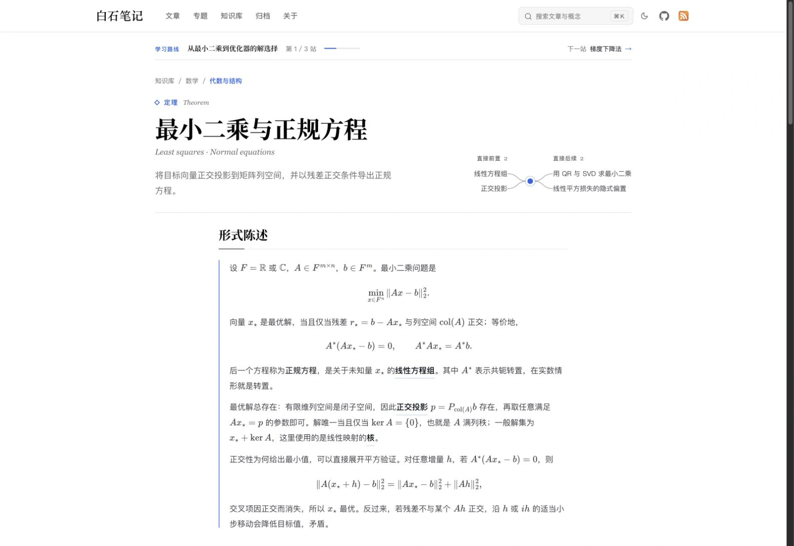

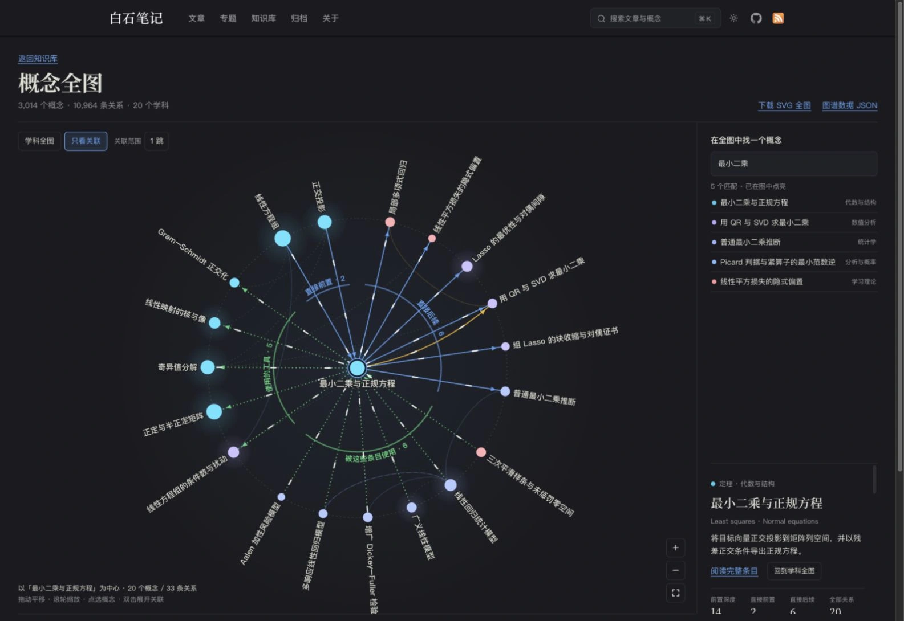

### 把一组概念组织成可走完的路线

学习路线在 `foundations.routes` 中独立配置：写清适合谁、读完能做什么，再用 `entries` 排出站点顺序。它可以跨学科，也可以让同一概念出现在多条路线里。`featured: true` 将路线放到首页精选区，`capstoneHref` 可以接上终点练习。

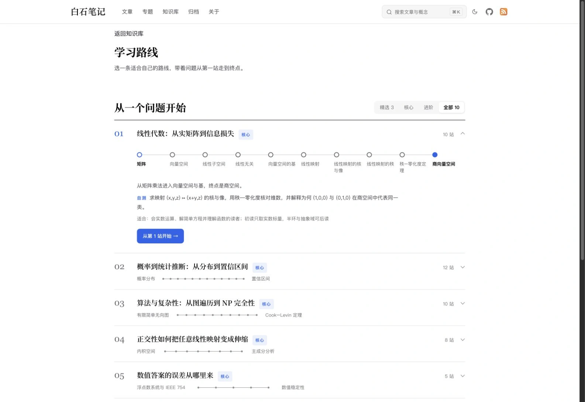

沿路线进入概念页后，页面会显示当前位置、上一站与下一站，到终点时提供练习入口。链接携带 `?route=<路线ID>`，刷新、返回和分享都保留这条路线。直接打开概念时则列出它所属的路线，让读者自行选择。

### 从全图看见跨学科的连接

概念全图把正式条目画成一张星盘：角度表示学科，半径表示最长前置链的深度，节点大小反映直接关系数量。


这张全图使用 [理路](https://www.codeboy.site/pages/foundations.html) 的数据进行演示。

可以搜索定位概念，按学科、类型和六种关系筛选，单独查看跨学科连线，或切换为所选概念的 1 跳 / 2 跳关联。右侧列出有方向的关系和正文入口。


按默认目录，在 `pages/` 下放置 `foundations.md`、`foundations-routes.md`、`foundations-map.md`，即可分别启用知识库、完整路线索引与概念全图。只创建需要的页面；启用独立路线索引后，知识库首页保留精选路线及完整索引的入口。

## 本地写作工作台

`tio2 cms` 同时启动文件 API、编辑器和站点预览。它直接读写项目里的 Markdown 文件。

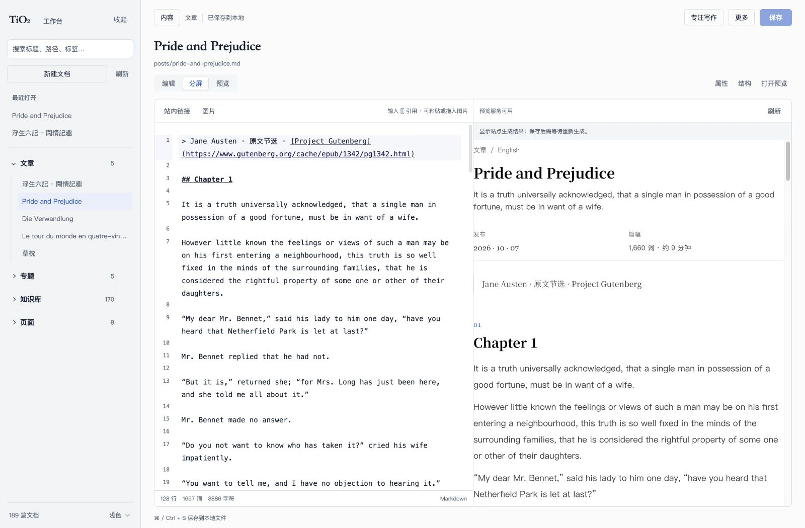

- CodeMirror 编辑器，编辑 / 分屏 / 预览 / 专注写作四种视图
- 输入 `[[` 补全文章、专题、页面与概念，输入 `#` 补全标题
- 图片可粘贴、拖入或从缩略图选择器挑选，上传文件以内容哈希命名
- 属性面板管理日期、分类、封面，以及知识库条目的类型、别名和六种关系
- 新建、移动、重命名、删除文档；`⌘S` 保存，`⌘K` 搜索全库

服务默认只监听 `127.0.0.1`，拒绝跨站来源的写入请求。

## 快速开始

> 当前为 `1.0.0-preview.1` 开发预览，尚未发布到 npm，需从源码打包安装。要求 Node.js 22.22.x，支持 macOS 与 Linux。

```bash
git clone https://github.com/CodeBoy2006/TiO2.git TiO2 && cd TiO2
pnpm install --frozen-lockfile
pnpm dev          # 用 examples/customized 启动开发站点
pnpm cms          # 启动写作工作台
```

在自己的项目中使用：

```bash
# 在框架仓库中打包
pnpm pack --pack-destination /tmp/tio2-local

# 在你的站点目录中（可从 examples/minimal 复制起步）
pnpm add /tmp/tio2-local/tio2-1.0.0-preview.1.tgz
pnpm exec tio2 dev
```

最小配置 `tio2.config.mjs` 只需要标题和地址：

```js
import { defineTiO2Config } from 'tio2'

export default defineTiO2Config({
    site: { title: '白石笔记', url: 'https://example.com', language: 'zh-CN' },
    theme: { nav: [{ text: '关于', link: '/pages/about' }] }
})
```

```text
my-site/
├── tio2.config.mjs
├── posts/          文章
├── topics/         专题（每个目录一个连载）
├── foundations/    知识库条目
├── pages/          页面与索引页（archives.md、tags.md、foundations.md …）
└── public/         原样复制的静态资源
```

目录名都可在 `content` 中改写；专题、知识库和各索引页均为可选，不需要就不建。

| 命令 | 作用 |
| --- | --- |
| `tio2 dev` | 开发站点，监听变更并自动刷新（默认端口 5000） |
| `tio2 build` | 构建并校验，输出到 `.tio2-tmp/site/` |
| `tio2 preview` | 本地预览生产构建（默认端口 4173） |
| `tio2 cms` | 写作工作台 + 站点预览 |
| `tio2 new "标题"` | 新建文章及其图片目录 |

所有命令可用 `--root <目录>` 指定项目。

## 部署

构建产物是一个纯静态目录，可以放到任何静态托管上：

```bash
pnpm exec tio2 build     # 产物位于 .tio2-tmp/site/
```

| 平台 | 设置 |
| --- | --- |
| Vercel / Netlify / Cloudflare Pages | 构建命令 `pnpm exec tio2 build`，输出目录 `.tio2-tmp/site`，Node 版本 22 |
| GitHub Pages | 在 Actions 中构建，将 `.tio2-tmp/site` 作为 Pages artifact 上传 |
| Nginx / 对象存储 / 自有服务器 | 把 `.tio2-tmp/site/` 同步过去即可 |

几点注意：

- `site.url` 要填线上地址，canonical、RSS / Atom / JSON Feed 与 sitemap 都由它生成。
- 生产构建默认排除 `draft/`、`trash/`、`private-notes/` 下的 Markdown。
- 加密块的口令通过环境变量 `BLOG_ENCRYPTION_SECRETS` 注入；Markdown 源文件里仍是明文，源码仓库请保持私有。
- 请保留产物中的第三方许可文件；内存吃紧时可用 `TIO2_BUILD_HEAP_MB` 调整构建堆上限。
- 评论（Giscus）与 Vercel Analytics 默认关闭，在配置中显式开启。

## 定制

- **样式与脚本**　`theme.clientEntry` 指向你的入口文件，可引入自定义 CSS 和浏览器模块。
- **整体布局**　`theme.layout` 导出一个渲染函数，包裹或替换默认文档外壳。
- **单页接管**　`theme.pages` 把某个 Markdown 源文件映射到自定义渲染模块，比如一张手写的「关于」页。
- **界面语言**　`site.language` 为 `zh*` 时使用中文界面，其余为英文；文章内容保持原样。

完整示例见 [examples/customized](examples/customized)。

## 技术栈与仓库结构

Eleventy · Vite · markdown-it · Shiki · MathJax · MiniSearch · Cytoscape · sharp；工作台使用 Vue、CodeMirror 与 Fastify。

| 路径 | 职责 |
| --- | --- |
| `packages/` | 配置、内容模型、文件系统操作、CMS 契约、主题变量 |
| `site/` | 静态渲染器、构建配置、浏览器端功能 |
| `.vitepress/theme/` | TiO₂ 自有的 Markdown 插件（不依赖 VitePress） |
| `apps/` | 本地 CMS 服务与写作工作台 |
| `bin/`、`scripts/` | CLI、构建调度与产物校验 |
| `examples/`、`tests/` | 示例项目与回归测试 |

参与开发：`pnpm check` 运行 lint、类型检查、测试与示例构建；`pnpm test:package` 在仓库外安装 tarball 并验证 CLI。发布策略与已知依赖公告见 [docs/releasing.md](docs/releasing.md)。

## 许可

框架代码以 [MIT](LICENSE) 许可发布；依赖、字体与图标保留各自的许可，。框架许可不涵盖你的文章与个人资源。

<sub>文中截图与知识图谱动图来自仓库外的临时演示站点，使用名著原文节选、AI 生成的氛围封面与 Codeboy 的知识笔记；概念全图及其关联视图使用完整知识库数据，动图直接驱动真实组件并编排镜头与交互。原文文件、知识库副本、图谱数据与封面原图仅用于演示，不随仓库或 npm 包分发；仓库只保留最终展示图片与动图。`examples/` 仍是可独立运行的精简示例。</sub>
